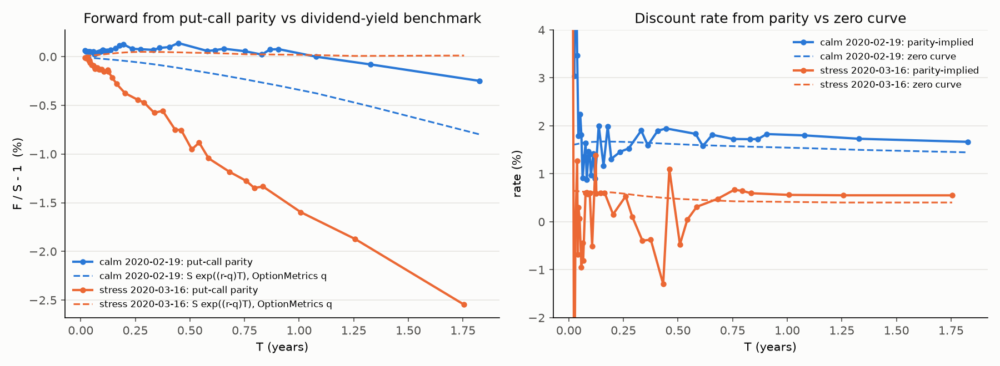
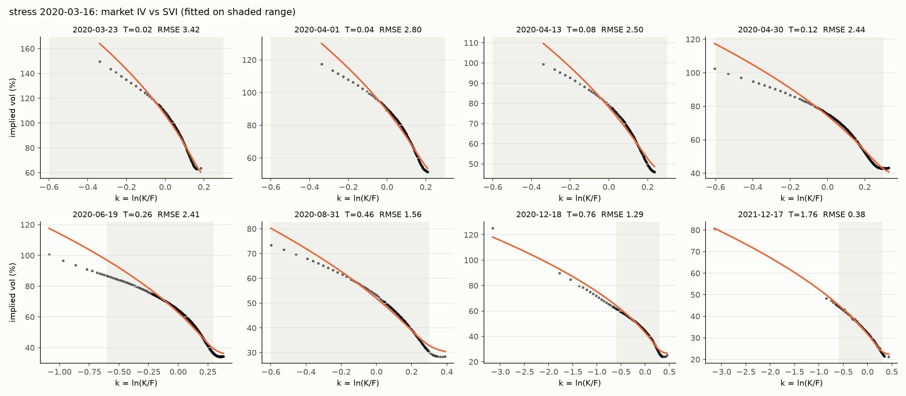
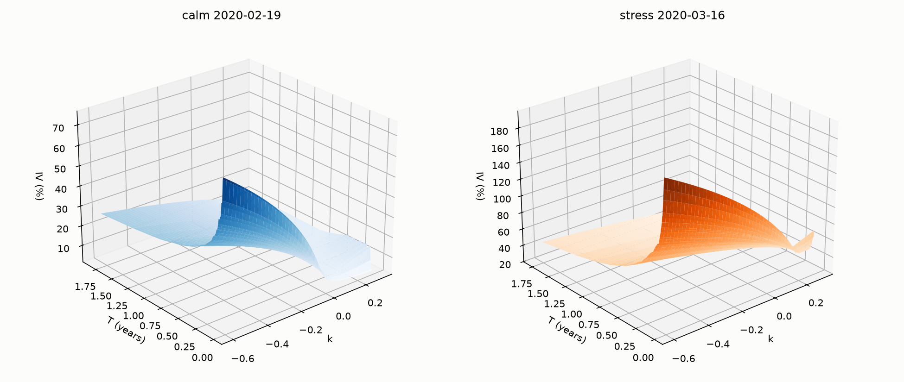
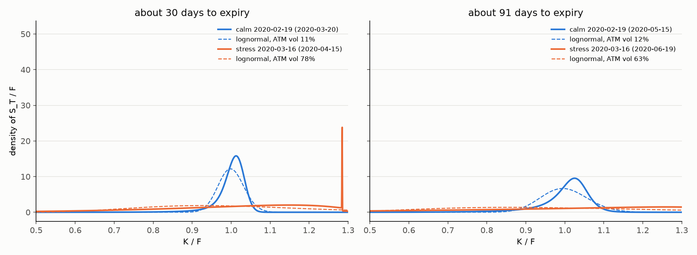
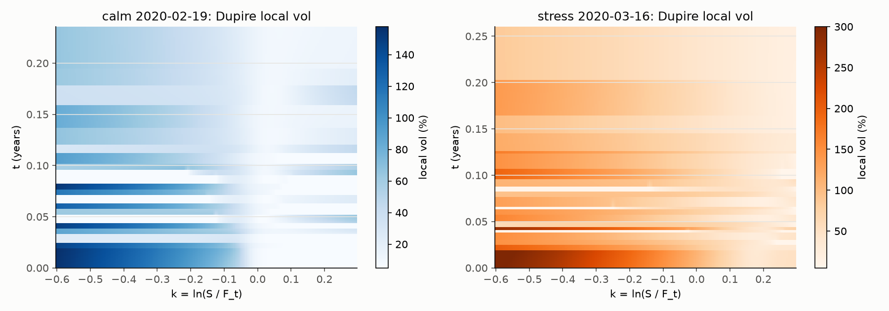
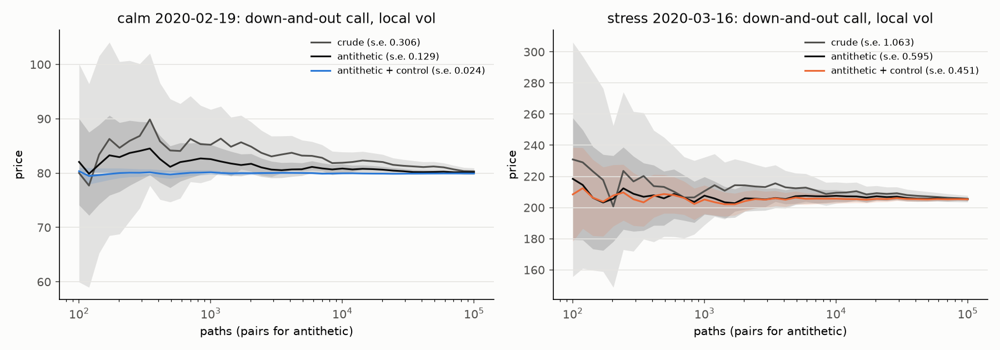

# SPX implied vol surface, risk-neutral density and local vol

SPX index options from OptionMetrics (WRDS) on a calm day, 19 Feb 2020, and a stress day,
16 Mar 2020. From the raw quotes: forwards by put-call parity, an SVI surface checked for
arbitrage, the risk-neutral density by Breeden-Litzenberger, and a Dupire local vol model used
to price a barrier option and an Asian option by Monte Carlo against Black-Scholes.

Three results worth knowing before the detail:

- OptionMetrics' dividend yield collapsed on 16 Mar 2020 and their implied vols inherit it.
  Parity-implied forwards fix it and reproduce their vols to 0.03 vol points once the same forward is used.
- The market priced a 20% fall over three months at 2.2% on the calm day; the lognormal at ATM vol says 0.0%.
- For path-dependent options, skew and term structure act separately: the barrier price moves with
  the skew, the Asian price with the term structure.

## Run

```
python -m venv ~/venvs/spxvol && ~/venvs/spxvol/bin/pip install -e .
~/venvs/spxvol/bin/python scripts/build.py
```

The first run pulls two days from WRDS through `~/.pgpass` and caches them in `data/`, which is
gitignored because OptionMetrics data cannot be redistributed. The full build takes about 30 seconds.
Keep the venv outside cloud-synced folders.

## Step 1: quotes, forwards, implied vols

Filters: bid > 0, ask > bid, spread at most 50% of mid, 7 to 730 days to expiry. SPX monthlies settle
on the Friday open and SPXW weeklies on the close; where both exist for one date the PM contract
is kept, and AM-settled T is shortened by 6.5 hours. Only out-of-the-money quotes are used.

Per expiry, put-call parity C - P = D (F - K) gives the forward F for strikes within 10% of spot,
with D from the zero curve. Implied vols come from Black-76 on the forward, inverted with Brent.



- A joint regression of C - P on K recovers the same forward to 0.01% but its discount factor is
  noise below three months, which is why D is taken from the zero curve.
- On 16 March the parity forward is 2.5% below spot at 1.75 years, i.e. the market still priced
  about 2% dividends, while OptionMetrics' dividend yield reads 0.4%. Their implied vols differ from
  ours by 0.7 vol points with opposite signs on puts and calls, the signature of a forward mismatch.

## Step 2: SVI surface

**Model.** Each expiry is a raw SVI slice in total variance w = sigma^2 T against log-moneyness k = ln(K/F):

    w(k) = a + b [ rho (k - m) + sqrt((k - m)^2 + sigma^2) ]

a sets the level, b the wing slopes, rho the asymmetry (negative for equity skew), m shifts the
smile, sigma rounds the kink. Wings are linear in k, consistent with Lee's moment bounds.

**Fit.** Bounded least squares in w on strikes from 55% to 135% of the forward, the range that
holds the density mass and the Step 4 payoffs. Each quote is weighted by 1/var(w) implied by its
bid-ask (half-spread divided by vega, times dw/dsigma), so tight near-the-money quotes dominate.
Nine starting points over (rho, m) guard against local minima. Constraints:

- a >= 0 and m inside the quoted k range. Without these the optimiser fits a steep skew with the
  far branch of the hyperbola (rho near +1, m far right), which extrapolates nonsensically.
- sigma >= 0.25 sigma_ATM sqrt(T). SVI is convex in w and the stress-day put wing is concave, so the
  unconstrained answer is a straight line with a zero-width kink at the edge of the range, which is
  a point mass in the density. The floor rounds it at a cost of 0.3 vol points on the stress day and
  nothing on the calm day.

**Checks.** Butterfly arbitrage: Gatheral's g(k) >= 0 on every slice (g is proportional to the
density in k). Calendar arbitrage: w must not decrease in T at any k; adjacent slices are compared
on the fitted range and violations reported. The surface used downstream interpolates w linearly
in T between slices, after a running maximum in T removes the violations.




- Mean fit error 0.8 vol points on the calm day, 2.2 on the stress day, all of it the concavity
  SVI cannot bend to.
- No butterfly violations. Calendar violations are small (worst 0.0014 in total variance on the
  calm day, 0.015 on the stress day) and sit at the edges of the fitted range.

## Step 3: risk-neutral density

From the slice's call prices C(K) on a strike grid from 0.05F to 4F, q(K) = (1/D) d2C/dK2 by central
differences. Mass integrates to 1.000 and the mean equals the forward on every slice. The lognormal
benchmark uses the same forward and the ATM vol.



| day | T | ATM vol | log-return skew | excess kurtosis | P(S < 0.9F) RN / LN | P(S < 0.8F) RN / LN |
|---|---|---|---|---|---|---|
| calm | 1M | 11% | -3.4 | 23 | 2.6% / 0.1% | 0.5% / 0.0% |
| calm | 3M | 12% | -2.9 | 16 | 7.5% / 4.2% | 2.2% / 0.0% |
| stress | 1M | 78% | -1.9 | 5.9 | 29% / 36% | 18% / 19% |
| stress | 3M | 63% | -2.1 | 6.1 | 32% / 43% | 24% / 30% |

- On the calm day the skew is the whole crash premium: the lognormal gives a 20% fall no chance.
- On the stress day the ATM vol alone already prices the crash. The market density is more peaked
  than the lognormal with a fatter far-left tail, and gives moderate falls a lower probability.
- Stress-day tails rest on the SVI wings, where the fit is weakest.

## Step 4: local vol and Monte Carlo

Dupire's equation in total variance is sigma_loc^2(k, T) = (dw/dT) / g(k, T), the calendar slope
over the butterfly term from Step 2. It is evaluated on the surface grid and clipped to [5%, 300%].
Monte Carlo is log-Euler on k_t = ln(S_t / F_t), so no rates or dividends appear; 200,000 antithetic
paths, 8 steps per day. At daily steps the Euler bias on the stress day is 0.2 to 0.5 vol points,
several standard errors. European calls under local vol reproduce the surface within 2 s.e. at
every strike on both days.




Three-month options struck at the forward, barrier at 90% of spot, daily monitoring and fixings.
Control variates: the European call for the barrier, the geometric Asian (closed form) for the
Asian under Black-Scholes. Prices in % of the forward; s.e. at most 0.02 on the stress day and
0.006 on the calm day. "BS with term structure" uses the ATM vol curve with no skew, to separate
the two effects.

| day | option | Black-Scholes | BS with ATM term structure | local vol |
|---|---|---|---|---|
| calm | European | 2.39 | 2.39 | 2.39 |
| calm | down-and-out call | 2.387 | 2.387 | 2.358 |
| calm | arithmetic Asian | 1.385 | 1.285 | 1.287 |
| stress | European | 12.72 | 12.72 | 12.71 |
| stress | down-and-out call | 8.69 | 9.06 | 8.64 |
| stress | arithmetic Asian | 7.53 | 9.04 | 9.08 |

- All three models agree on the vanilla, so the differences are path-dependence only.
- The barrier is the skew effect. Local vol is higher below spot, so more paths knock out: 1.2%
  cheaper than Black-Scholes on the calm day, 4.6% cheaper than the term-structure model on the stress day.
- The Asian is the term-structure effect. Calm-day vol slopes up with maturity, so the average fixes
  under lower early vol (7% cheaper); stress-day vol is inverted (20% dearer). Black-Scholes with the
  right ATM term structure lands within 0.5% of local vol.



Per random draw, antithetic pairs cut the standard error of the barrier price by about 1.7x. The
European control variate cuts it a further 5x on the calm day but only 1.3x on the stress day,
where most paths knock out and the vanilla payoff is a poor proxy.

## Layout

| Path | Contents |
|---|---|
| `src/spxvol/black.py` | Black-76 pricer, vega, Brent implied vol |
| `src/spxvol/data.py` | one-day WRDS pull with parquet cache |
| `src/spxvol/clean.py` | filters, forwards, own implied vols |
| `src/spxvol/svi.py` | raw SVI fit, butterfly function g(k) |
| `src/spxvol/surface.py` | per-expiry fits, calendar check, surface grid |
| `src/spxvol/density.py` | Breeden-Litzenberger density and moments |
| `src/spxvol/localvol.py` | Dupire local vol on the surface grid |
| `src/spxvol/mc.py` | log-Euler simulation, antithetic pairs, control variates, geometric Asian closed form |
| `scripts/build.py` | rebuilds every figure and table |

## Limitations

- Raw SVI cannot fit concave total variance; stress-day wings beyond the fitted range are extrapolated.
- Calendar consistency is imposed after the fit. SSVI would build it in, at the cost of fit quality.
- Local variance is the T-derivative of per-expiry fits and inherits their noise as horizontal bands
  between weekly expiries. Vanilla prices are unaffected; smoothing the term structure would clean it.
- Log-Euler needs 8 steps per day on the stress day. A higher-order scheme would be cheaper.
- Quotes are end-of-day closes; intraday timing of the index level and option quotes is not aligned.

## What I learned

