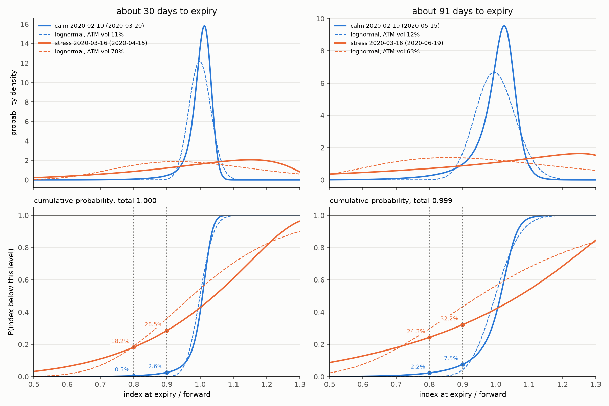
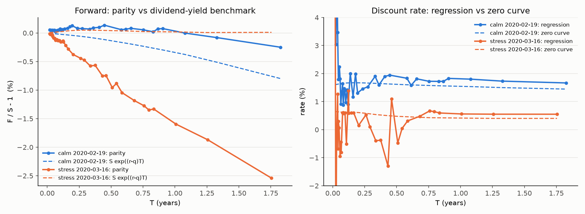
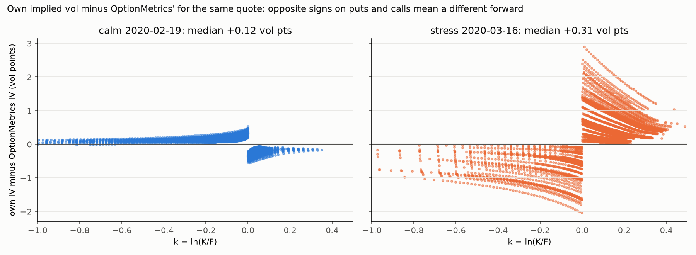
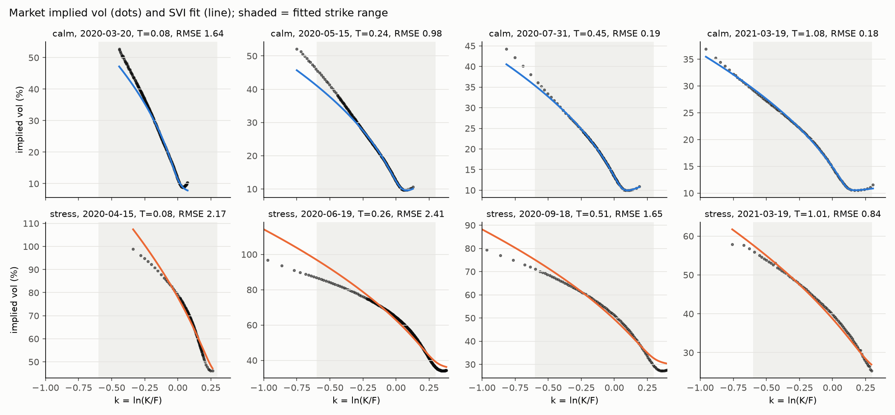
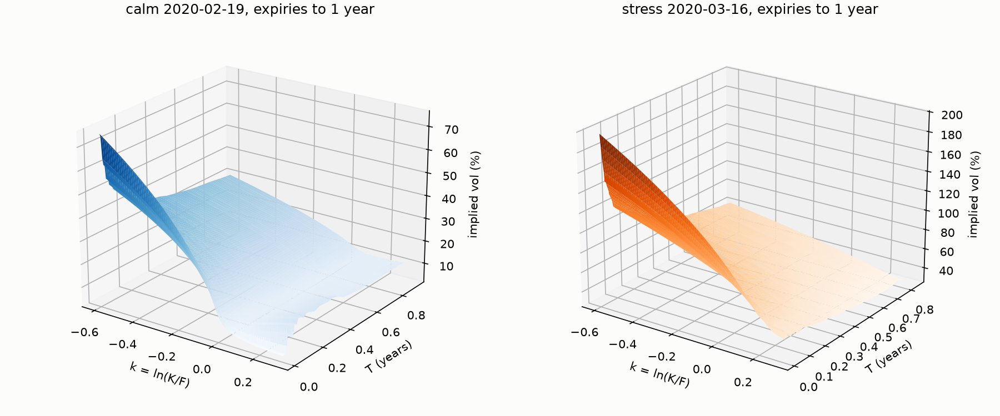
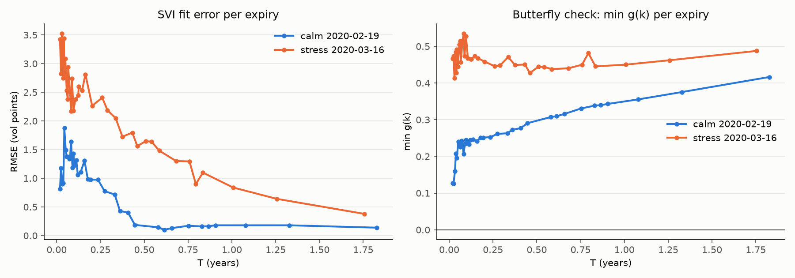

# What the S&P 500 options market expects

Option prices encode a probability distribution for where the index will be at expiry. This
project extracts it from SPX option quotes (OptionMetrics via WRDS) on two days: 19 Feb 2020, the
all-time high before Covid, and 16 Mar 2020, the day the VIX closed at a record 83.



Top row: the market-implied probability density of the index at expiry (solid) against the
lognormal that Black-Scholes assumes (dashed). Bottom row: the same as cumulative probability,
which reaches 1.000, with the probability of a 10% and a 20% fall marked.

| day | T | ATM vol | log-return skew | excess kurtosis | P(fall > 10%) market / lognormal | P(fall > 20%) market / lognormal |
|---|---|---|---|---|---|---|
| calm | 1M | 11% | -3.4 | 23 | 2.6% / 0.1% | 0.5% / 0.0% |
| calm | 3M | 12% | -2.9 | 16 | 7.5% / 4.2% | 2.2% / 0.0% |
| stress | 1M | 78% | -1.9 | 5.9 | 29% / 36% | 18% / 19% |
| stress | 3M | 63% | -2.1 | 6.1 | 32% / 43% | 24% / 30% |

On the calm day the lognormal gives a 20% fall over three months no chance; the market charged
2.2% for it. That gap is the crash premium, and it lives entirely in the skew. On the stress day
the level of volatility alone already prices the crash, and the market distribution is more
peaked than the lognormal with a fatter far-left tail.

## Plain terms

- **An option** pays off if the index finishes above (call) or below (put) a chosen level, the
  strike, at a chosen date, the expiry. Its price is mostly a bet on how much the index will move.
- **Implied volatility** is that bet in standard units: the volatility that makes the Black-Scholes
  formula reproduce the quoted price. One number per option.
- **The smile** is implied volatility plotted against strike. For an index it slopes down: puts
  that pay off in a crash cost more than a single volatility would imply. That slope is the skew.
- **The forward** is the price at which you could agree today to buy the index at expiry. Every
  strike here is measured against it.
- **The risk-neutral density** is the probability distribution of the index at expiry that the
  option prices imply. It is what the market is willing to pay for each outcome, not a forecast.
- **Arbitrage** is a combination of trades that can only make money. A fitted curve that allows one
  is inconsistent, so "arbitrage-free" is the basic sanity requirement.

## Run

```
python -m venv ~/venvs/spxvol && ~/venvs/spxvol/bin/pip install -e .
~/venvs/spxvol/bin/python scripts/build.py
```

The first run pulls the two days from WRDS through `~/.pgpass` and caches them in `data/`, which
is gitignored because OptionMetrics data cannot be redistributed. The build takes a few seconds.
`results/` holds the main outputs (the density figure and `density_stats.csv`); `figures/` holds
diagnostics, named by step.

## Step 1: quotes, forwards, implied vols

I keep quotes with bid > 0, ask > bid, a spread at most 50% of mid, and 7 to 730 days to expiry.
SPX monthlies settle on the Friday open and SPXW weeklies on the close; where both exist for one
date I keep the PM contract, and shorten T by 6.5 hours for AM-settled expiries. I use
out-of-the-money quotes only: an in-the-money option's time value is a tiny fraction of its price,
so its implied vol is numerically meaningless.

A call and a put at the same strike obey put-call parity, C - P = D (F - K). Owning the call and
selling the put is the same as agreeing to buy the index at K whatever happens, so the pair must
cost the gap between forward and strike, discounted to today. D is the discount factor from the
zero curve; with D known, every call-put pair gives an estimate of F, and I average those from
strikes within 10% of spot. Implied vols then come from the Black-76 formula on the forward,
inverted with Brent's method.



- A joint regression of C - P on K recovers the same forward to 0.01% but its discount factor is
  noise below three months, so I take D from the zero curve and use parity for F only.
- On 16 March the parity forward is 2.5% below spot at 1.75 years: the market still priced about
  2% in dividends, while OptionMetrics' dividend yield reads 0.4%. Their implied vols differ from
  mine by 0.7 vol points with opposite signs on puts and calls, which is what a wrong forward looks
  like. Given their forward, my solver reproduces their vols to 0.03 vol points.



## Step 2: SVI smile per expiry

Quotes exist only at listed strikes. To take derivatives in Step 3 I need a smooth curve through
them that admits no arbitrage. SVI ("stochastic volatility inspired", Gatheral 2004) is the
standard choice for index smiles.

### The model

Two changes of variable. Instead of implied vol I use total variance w = sigma^2 T, the total
amount of "spread" the market expects by that date. Instead of the strike I use log-moneyness
k = ln(K/F): zero at the forward, about -0.1 for a strike 10% below it. Each expiry is then a
rounded V in k:

    w(k) = a + b [ rho (k - m) + sqrt((k - m)^2 + sigma^2) ]

| Parameter | What it does | Constraint |
|---|---|---|
| a | overall level | a >= 0 |
| b | steepness of both wings | b >= 0 |
| rho | asymmetry: -1 is a one-sided put skew, +1 a call skew | -1 < rho < 1 |
| m | horizontal position of the smile minimum | inside the quoted k range |
| sigma | width of the rounded kink at the minimum; 0 is a sharp V | >= 0.25 sigma_ATM sqrt(T) |

Far from the money the curve is a straight line in k, which is the shape Lee's moment formula
requires, so SVI extrapolates sensibly beyond the last quote.

### Fitting one slice

1. Take the out-of-the-money quotes with strikes between 55% and 135% of the forward, the range
   that holds essentially all the probability mass.
2. Convert each implied vol to total variance.
3. Weight each quote by one over its uncertainty squared. The uncertainty comes from the bid-ask
   spread: half the spread in price, divided by vega (how much the price moves per unit of vol),
   then converted to variance units. Tight near-the-money quotes dominate; unweighted least squares
   in w does the opposite and misses the smile minimum.
4. Bounded least squares from nine starting points over (rho, m), keeping the best.
5. Record the fit error in vol points and the minimum of the butterfly function g(k).

Two of the bounds exist because of what went wrong without them. My first fit came back with
rho = +0.93 and m = 0.69: the optimiser had matched a steep put skew with the far branch of the
hyperbola, which fits the quotes and then extrapolates to a density with mass 1.04 and positive
skew. Hence a >= 0 and m inside the quoted range. On the stress day every slice then hit sigma = 0
with m at the edge of the range. SVI is convex in w and the 16 March put wing is concave, so the
best convex approximation is a straight line with a zero-width kink pushed to the boundary, which
is a point mass in the density. The floor on sigma scales with the smile width, rounds the kink on
the stress day (0.3 vol points of extra error) and does nothing on the calm day.

### Arbitrage checks

Butterfly arbitrage means the curve implies a negative probability somewhere. You do not need to
read the formula to use it: its sign is the sign of the implied probability. Gatheral and
Jacquier (2014) show a slice is free of butterfly arbitrage if and only if

    g(k) = (1 - k w'/(2w))^2 - (w'/4) (1/w + 1/4) + w''/2  >=  0

I evaluate it on a fine k grid for every slice. No slice violates it on either day.

Calendar arbitrage means a longer-dated option is cheaper than a shorter one at the same
moneyness. The condition is w non-decreasing in T at every k. Per-slice fits do not enforce it,
so I compare adjacent expiries and report violations: ten pairs on the calm day with worst 0.0014
in total variance, eleven on the stress day with worst 0.015, all at the edges of the fitted range.





Mean fit error is 0.8 vol points over 36 expiries on the calm day and 2.2 on the stress day. The
stress residuals have the same pattern on every slice, above the market in both wings and below it
near the money: SVI is convex in total variance and that smile is not.

## Step 3: risk-neutral density

A probability density is a curve whose area between two index levels is the probability the index
finishes between them. Breeden and Litzenberger (1978) showed the option market draws this curve:
the second derivative of the call price with respect to strike is the discounted density. Buy a
call at K - h, sell two at K, buy one at K + h; that package pays out only if the index lands
within h of K, so its price divided by the payout size is the probability of that band. Let h
shrink and you have the density at K.

I evaluate the SVI slice's call prices on 8,001 strikes from 0.05F to 4F and take the second
derivative by central differences. Mass integrates to 1.000 and the mean equals the forward on
every slice. The benchmark is the lognormal with the same forward and the ATM vol. Results are in
the figure and table at the top.

## Layout

| Path | Contents |
|---|---|
| `src/spxvol/data.py` | one-day WRDS pull with parquet cache |
| `src/spxvol/clean.py` | filters, forwards, own implied vols |
| `src/spxvol/black.py` | Black-76 pricer, vega, Brent implied vol |
| `src/spxvol/svi.py` | raw SVI fit, butterfly function g(k) |
| `src/spxvol/surface.py` | per-expiry fits, calendar check |
| `src/spxvol/density.py` | Breeden-Litzenberger density and moments |
| `scripts/build.py` | rebuilds `results/` and `figures/` |

## Limitations

- Raw SVI cannot fit concave total variance; stress-day tails beyond the fitted range are
  extrapolated, so I would quote the stress-day 20% fall probability to one significant figure.
- Calendar consistency is checked, not enforced. SSVI would build it in at the cost of fit quality.
- Quotes are end-of-day closes; the index level and option quotes are not timed to the second.
