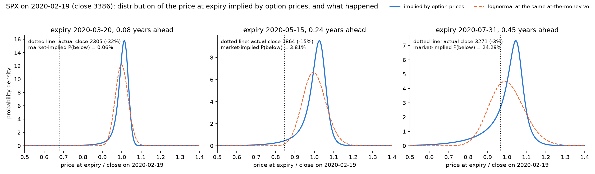

# What the options market thought was possible on 19 February 2020

On 19 February 2020 the S&P 500 closed at 3,386, its all-time high before Covid. A month later it
closed at 2,305, down 32%. Option prices on that day encode a probability distribution for where
the index would be at each expiry. I extracted it to ask: what chance did the market give to what
actually happened?



| expiry | horizon | actual close | market-implied probability of that or worse | lognormal |
|---|---|---|---|---|
| 20 Mar 2020 | 1 month | 2,305 (-32%) | 0.06% | 0.00% |
| 15 May 2020 | 3 months | 2,864 (-15%) | 3.8% | 0.3% |
| 31 Jul 2020 | 6 months | 3,271 (-3%) | 24% | 36% |

About 1 in 1,700 for the one-month outcome. The lognormal distribution that Black-Scholes assumes,
at the same at-the-money volatility, says about 1 in a million. The whole difference is the skew:
the extra the market charges for puts that pay off in a crash. It was pricing a crash as far
likelier than a textbook model would, and still an order of magnitude too complacent.

## Method

One script, `implied_distribution.py`. Breeden and Litzenberger (1978): the probability density of
the price at expiry is the second derivative of the call price with respect to strike. Quotes are
too coarse and noisy to differentiate twice, so:

1. Pull the day's SPX quotes from OptionMetrics (WRDS). Keep bid > 0, ask > bid, spread at most
   half the mid, 7 days to 3 years out, out-of-the-money contracts only.
2. Back out the forward per expiry from put-call parity, C - P = D (F - K), with the discount
   factor D from the zero curve.
3. Convert mid prices to implied vols with Black-76 on the forward, inverted with Brent's method.
4. Fit an SVI smile to each expiry in total variance against log-moneyness, weighting each quote
   by the precision its bid-ask implies.
5. Evaluate the fitted call prices on a fine strike grid and take the second difference. Mass
   integrates to 1.000 and the mean equals the forward on every expiry.

```
python implied_distribution.py SPX 2020-02-19
```

Quotes are cached in `data/`, which is gitignored because OptionMetrics data cannot be
redistributed. The realised closes come from Yahoo Finance.

## Why smooth first, and what it costs

Differentiating twice amplifies noise. Quotes sit on a coarse strike grid with bid-ask noise of a
few cents, and second differences of raw prices give a density that is jagged and negative in
places. Fitting a smooth curve first fixes that, and SVI in particular has known no-arbitrage
conditions, so the density it implies is positive by construction and extrapolates sensibly past
the last quoted strike, which matters because the tail is where the question lives.

The cost is that the answer in the tail is partly the model's. SVI is convex in total variance;
the 1-month smile fits to 1.6 vol points, so near the money the curve is the market, but below
the lowest liquid strike the density is SVI's extrapolation of the market. The 0.06% is therefore
a model-smoothed number, and I would quote it to one significant figure. A looser smoother (a
spline, a kernel) tracks the quotes more closely but has to be forced not to produce negative
probabilities; a tighter one (a lognormal mixture) is arbitrage-free but harder to read.

## Risk-neutral versus real-world probability

The distribution option prices imply is the risk-neutral one: the probabilities under which
discounted prices are fair bets. It is the real-world distribution reweighted by how much people
value a dollar in each state. A dollar in a crash is worth more than a dollar in a boom, because
that is when you need it, so crash states carry more weight in the risk-neutral measure than
their real-world frequency.

Two consequences. First, the 0.06% is not what the market "thought" would happen; it is what it
was willing to pay, which includes insurance value. The probability investors actually assigned
was lower still. Second, that makes the result stronger, not weaker: even with a crash premium
built in, the market priced the March outcome at 1 in 1,700. Recovering the real-world
distribution would need an assumption about risk aversion (a pricing kernel), which is a
separate project and a separate set of arguments.
