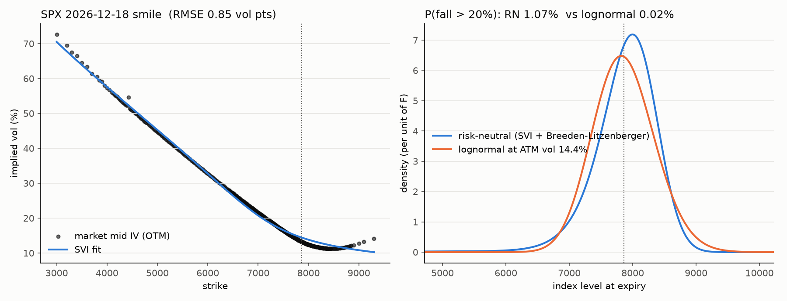

# SPX implied volatility surface, risk-neutral density and local vol

From SPX option prices (OptionMetrics via WRDS): an arbitrage-free SVI implied
volatility surface, the risk-neutral density by Breeden-Litzenberger, and a Dupire
local vol model with Monte Carlo pricing of path-dependent options, on a calm day
and a stress day.

**Status:** Black-76 pricer, implied vol solver, SVI slice fit and risk-neutral
density are done and tested. WRDS pull, surface across expiries, Dupire local vol
and Monte Carlo are next.

## Setup

```
python -m venv .venv
.venv/bin/pip install -e ".[dev,yf]"
.venv/bin/pytest
```

WRDS credentials live in `~/.pgpass`, never in code. Raw data is cached in `data/`,
which is gitignored because OptionMetrics data cannot be redistributed.

## Layout

| Path | Contents |
|---|---|
| `src/spxvol/black.py` | Black-76 pricer on the forward, vega, Brent implied vol |
| `src/spxvol/svi.py` | raw SVI fit per expiry, Gatheral butterfly check g(k) |
| `src/spxvol/density.py` | Breeden-Litzenberger density from SVI, lognormal benchmark, moments and tail probabilities |
| `src/spxvol/data.py` | one-day SPX pull from WRDS OptionMetrics with parquet cache |
| `scripts/yf_density.py` | fallback: same pipeline on today's Yahoo Finance chain |
| `tests/` | put-call parity, IV round trip, SVI recovery and derivatives, density mass and mean |
| `figures/` | generated plots |

## Preview result (Yahoo Finance, one expiry)

`python scripts/yf_density.py 2026-12-18` on 12 Oct 2026:



| | risk-neutral | lognormal at ATM vol |
|---|---|---|
| log-return skew | -3.0 | 0 |
| excess kurtosis | 22 | 0 |
| P(fall > 10%) | 5.9% | 4.7% |
| P(fall > 20%) | 1.1% | 0.02% |

## Method

1. Keep quotes with bid > 0, ask > bid and relative spread at most 50%; use OTM
   options only (puts below the forward, calls above).
2. Back out the forward F and discount factor D per expiry from put-call parity,
   C - P = D (F - K), by regressing C - P on K near the money.
3. Recompute implied vols from mid prices with Black-76 on the forward and Brent's method.
4. Fit raw SVI to total variance w(k) = sigma^2 T in log-moneyness k = ln(K/F),
   with a >= 0 and the smile minimum inside the quoted range so the fit is
   well-posed. Check Gatheral's g(k) >= 0 for butterfly arbitrage.
5. Density q(K) = (1/D) d^2C/dK^2 by central differences of SVI-implied call prices
   on a fine strike grid. Compare with the lognormal at ATM vol.

## Limitations

- Yahoo quotes are delayed and not time-synchronised; deep OTM puts trade in
  50-cent markets so their implied vols are rough. The WRDS data will replace this.
- Raw SVI per expiry does not guarantee calendar consistency across expiries.
- SVI with rho near -1 misses the slight upturn in far OTM call vols.

## What I learned

