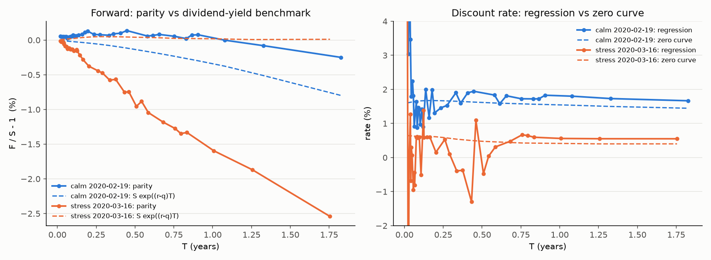
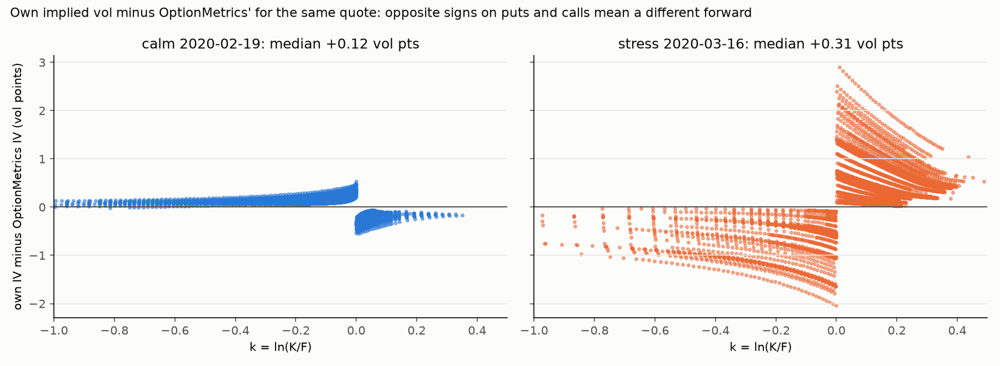
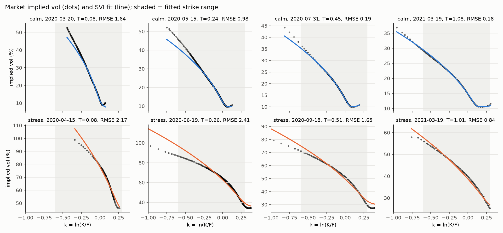
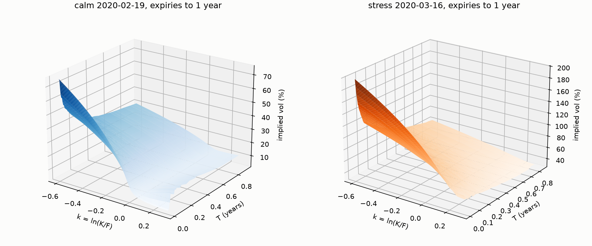
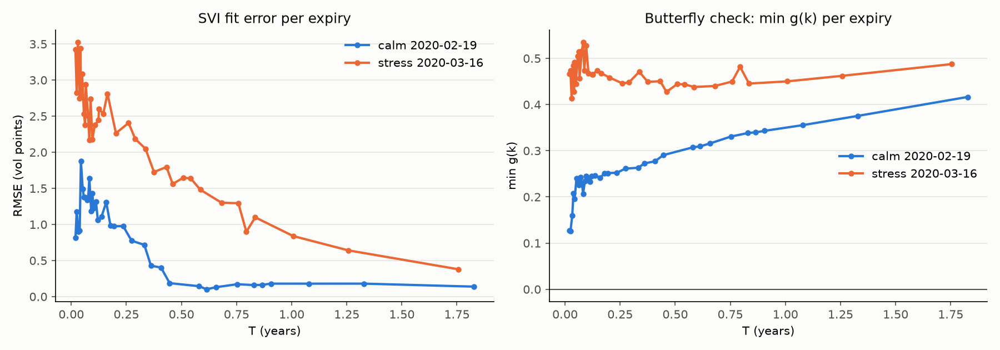
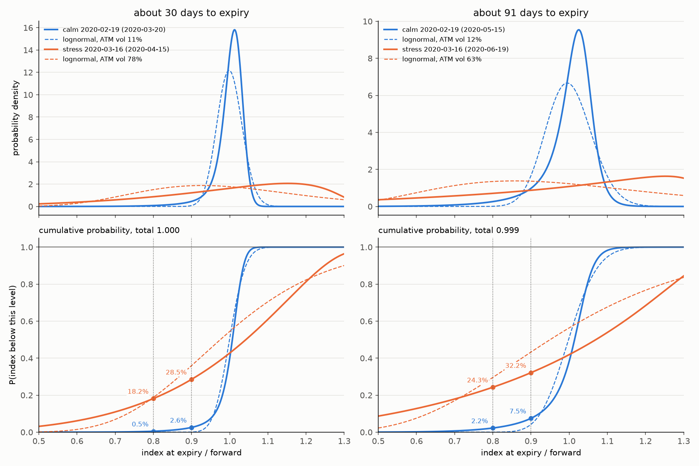
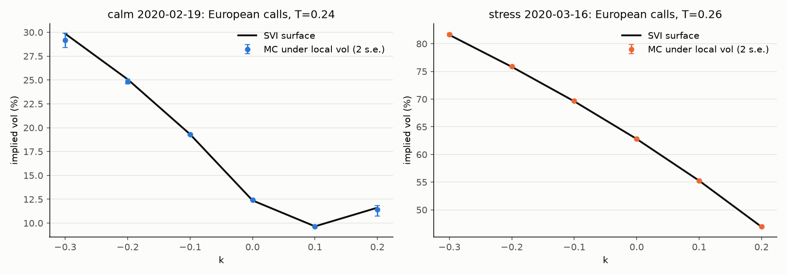
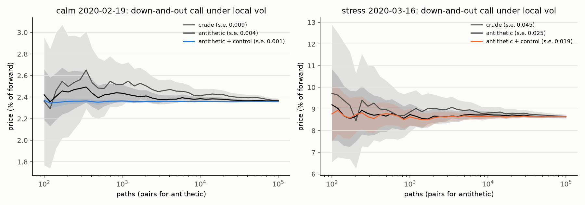

# SPX implied vol surface, risk-neutral density and local vol

What the options market on the S&P 500 said about the future on two days: 19 Feb 2020, the day
the index hit its all-time high before Covid, and 16 Mar 2020, the day the VIX fear index closed
at a record 83. From thousands of raw option quotes on each day, this project recovers the
market's implied probability distribution for the index, builds a pricing model that matches every
quoted option, and uses it to price two options whose value depends on the path the index takes.

## The idea in plain terms

- **An option** is a contract paying off if the index finishes above (call) or below (put) a
  chosen level, the strike, at a chosen date, the expiry. Its price is mostly a bet on how much the
  index will move.
- **Implied volatility** is that bet in standard units: the annualised standard deviation of index
  returns that makes the Black-Scholes formula reproduce the quoted price. One number per option.
- **The smile** is implied volatility plotted against strike. For an index it slopes down: puts
  that pay off in a crash cost more than the formula's single volatility would suggest. The slope is
  the skew, and the whole set of smiles across expiries is the volatility surface.
- **The forward** is the price at which you could agree today to buy the index at expiry. It is
  spot adjusted for interest and dividends, and every strike in this project is measured against it.
- **The risk-neutral density** is the probability distribution of the index at expiry that the
  option prices imply. It is what the market is willing to pay for each outcome, not a forecast.
- **Local volatility** is a model in which volatility depends on the index level and time. It is
  the unique such model that reproduces every quoted option price at once, so it is the natural tool
  for pricing options that quotes do not cover.
- **Monte Carlo** simulates many possible index paths under a model and averages the payoff. The
  answer comes with a standard error, the statistical uncertainty from using a finite number of paths.
- **Arbitrage** is a combination of trades that can only make money. A set of option prices that
  allows one is inconsistent, so "arbitrage-free" is the basic sanity requirement on any fitted curve.

## Main outputs

| File | What it is |
|---|---|
| `results/risk_neutral_density.png` | the market-implied distribution of the index, calm vs stress, against the lognormal |
| `results/density_stats.csv` | its moments and tail probabilities |
| `results/exotic_prices.csv` | barrier and Asian prices under local vol, Black-Scholes, and Black-Scholes with term structure |

Everything in `figures/` is a diagnostic, named by step.

## Run

```
python -m venv ~/venvs/spxvol && ~/venvs/spxvol/bin/pip install -e .
~/venvs/spxvol/bin/python scripts/build.py
```

The first run pulls two days from WRDS through `~/.pgpass` and caches them in `data/`, which is
gitignored because OptionMetrics data cannot be redistributed. The full build takes about 30 seconds.
Keep the venv outside cloud-synced folders.

## Step 1: quotes, forwards, implied vols

Raw quotes need cleaning, and the forward has to be known before any implied volatility is
meaningful. I keep quotes with bid > 0, ask > bid, a spread at most 50% of mid, and 7 to 730 days to
expiry. SPX monthlies settle on the Friday open and SPXW weeklies on the close; where both exist for
one date I keep the PM contract, and I shorten T by 6.5 hours for AM-settled expiries. I use
out-of-the-money quotes only. An in-the-money option's time value is a tiny fraction of its price,
and a deep in-the-money call at 8% vol turned out to have time value below float precision, so its
implied vol is numerically meaningless.

A call and a put at the same strike obey put-call parity, C - P = D (F - K). Owning the call and
selling the put is the same as agreeing to buy the index at K, whatever happens, so the pair must
cost what that agreement is worth: the gap between forward and strike, discounted to today. D is
the discount factor, the value today of one dollar at expiry, taken from the zero curve (the
interest rates OptionMetrics supplies). With D known, every call-put pair gives an estimate of F,
and I average those from strikes within 10% of spot. No model is involved. Implied vols then come
from the Black-76 formula on the forward, inverted numerically with Brent's method (a safe
root-finder: the price rises with volatility, so there is exactly one answer).



- A joint regression of C - P on K recovers the same forward to 0.01% but its discount factor is
  noise below three months, so I take D from the zero curve and use parity for F only.
- On 16 March the parity forward is 2.5% below spot at 1.75 years, i.e. the market still priced
  about 2% dividends, while OptionMetrics' dividend yield reads 0.4%. Their implied vols differ from
  ours by 0.7 vol points with opposite signs on puts and calls, which is what a wrong forward looks
  like: it pushes puts and calls in opposite directions. Given their forward, my solver reproduces
  their vols to 0.03 vol points, so the solver is exact and the forward is the whole disagreement.



## Step 2: SVI surface

Quotes exist only at listed strikes and expiries. A smooth curve through them is needed to take
derivatives (Step 3) and to price options at arbitrary levels (Step 4), and it must not admit
arbitrage, i.e. combinations of options with negative price. SVI ("stochastic volatility
inspired", Gatheral 2004) is the standard choice for equity index smiles.

### The model

Each expiry gets its own slice. Two changes of variable first. Instead of implied vol I use total
variance w = sigma^2 T, implied vol squared times the time to expiry: it is the total amount of
"spread" the market expects by that date, and it is the quantity the no-arbitrage rules are stated
in. Instead of the strike I use log-moneyness k = ln(K/F): zero at the forward, about -0.1 for a
strike 10% below it, +0.1 for 10% above, so smiles at different index levels line up. The slice is
then a hyperbola in k, a rounded V:

    w(k) = a + b [ rho (k - m) + sqrt((k - m)^2 + sigma^2) ]

Five parameters, each with a visible effect on the curve:

| Parameter | What it does | Constraint |
|---|---|---|
| a | overall level: shifts the whole curve up or down | a >= 0 |
| b | steepness of both wings | b >= 0 |
| rho | asymmetry: -1 is a one-sided put skew, +1 a call skew, 0 symmetric | -1 < rho < 1 |
| m | horizontal position of the smile minimum | inside the quoted k range |
| sigma | width of the rounded kink at the minimum; 0 is a sharp V | >= 0.25 sigma_ATM sqrt(T) |

Far from the money the curve is a straight line in k with slope b(1 - rho) on the left and
b(1 + rho) on the right. That is the shape Lee's moment formula requires (total variance can grow
at most linearly in |k|), so SVI extrapolates sensibly beyond the last quote.

### Fitting one slice

1. Take the out-of-the-money quotes for that expiry with strikes between 55% and 135% of the
   forward. That range holds essentially all the probability mass and all the Step 4 payoffs.
2. Convert each implied vol to total variance, w = sigma^2 T.
3. Give each quote a weight equal to one over its uncertainty squared, so precise quotes count
   more. The uncertainty comes from the bid-ask spread: half the spread in price, converted to vol
   units by dividing by vega (how much the price moves per unit of vol), then to variance units.
   Tight near-the-money quotes get large weights, wide wing quotes small ones. Unweighted least
   squares in w does the opposite, because w itself is largest in the wings, and it misses the
   smile minimum.
4. Minimise the weighted sum of squared errors with bounded least squares, from nine starting
   points over (rho, m), keeping the best.
5. Record the fit error in vol points and the minimum of the butterfly function g(k) over the
   fitted range.

Two of the bounds exist because of what went wrong without them. My first fit on live data came
back with rho = +0.93 and m = 0.69: the optimiser had matched a steep put skew using the far
branch of the hyperbola, which fits the quotes to 0.2 vol points and then extrapolates to a
density with mass 1.04 and positive skew. Hence a >= 0 and m inside the quoted range. On the
stress day every slice then hit sigma = 0 with m at the edge of the range. SVI is convex in w
(its second derivative is b sigma^2 / r^3 > 0) and the 16 March put wing is concave, so the best
convex approximation is a straight line with a zero-width kink pushed to the boundary. A zero-width
kink is a point mass in the density, which showed up as a spike at 1.3 times the forward. The
floor on sigma scales with the smile width sigma_ATM sqrt(T), so it rounds the kink on the stress
day (0.3 vol points of extra error) and does nothing on the calm day, where the fitted sigma was
already above it.

### Arbitrage checks

Butterfly arbitrage means the fitted curve implies a negative probability for some range of index
levels, which would let you buy a spread of options that pays out for free. You do not need to read
the formula to use it: it is a function of the curve and its slope and curvature whose sign is the
sign of the implied probability. Gatheral and Jacquier (2014) show a slice is free of butterfly
arbitrage if and only if

    g(k) = (1 - k w'/(2w))^2 - (w'/4) (1/w + 1/4) + w''/2  >=  0

where w' and w'' are the first and second derivatives in k. g is proportional to the density in
k, so this is the same condition as the density being positive. I evaluate it on a fine k grid
for every slice. No slice violates it on either day.

Calendar arbitrage means a longer-dated option is cheaper than a shorter one at the same
moneyness, which is impossible since the longer one can be converted into the shorter. The
condition is w(k, T2) >= w(k, T1) for T2 > T1 at every k. Per-slice fits do not enforce this,
so I compare each adjacent pair on the fitted range and report every violation.

### Assembling the surface

The surface used by Dupire in Step 4 lives on a grid in (k, T). Total variance is evaluated from
each slice on the k grid, a running maximum in T removes the calendar violations, and w is
interpolated linearly in T between expiries and proportionally to T before the first one. The
size of the largest running-maximum adjustment is reported so the correction stays visible.

### What the diagnostics show





- Mean fit error 0.8 vol points over 36 expiries on the calm day, 2.2 on the stress day. Near the
  money on the calm day the error is 0.1 to 0.2 vol points, about the bid-ask.
- The residual pattern is the same on every stress slice: the fit sits above the market in both
  wings and below it near the money. SVI is convex in total variance and that smile is not. The
  error is misspecification, not noise.
- No butterfly violations. Calendar violations are small (worst 0.0014 in total variance on the
  calm day, 0.015 on the stress day) and sit at the edges of the fitted range.

## Step 3: risk-neutral density

A probability density is a curve whose area between two index levels is the probability the index
finishes between them. Breeden and Litzenberger (1978) showed the option market draws this curve
for you: the second derivative of the call price with respect to strike is the discounted density.
Intuitively, buy a call at K - h, sell two at K, buy one at K + h. That package pays out only if
the index lands within h of K, so its price, divided by the size of the payout, is the probability
of that narrow band. Let h shrink and you have the density at K.
From the slice's call prices C(K) on a strike grid from 0.05F to 4F, q(K) = (1/D) d2C/dK2 by
central differences. The benchmark is the lognormal distribution Black-Scholes assumes, with the same
forward and the ATM vol. The top row is the density; the bottom row is its running total, which
reaches 1.000 on every slice, with the probability of a 10% and a 20% fall marked. The mean equals
the forward on every slice.



| day | T | ATM vol | log-return skew | excess kurtosis | P(S < 0.9F) RN / LN | P(S < 0.8F) RN / LN |
|---|---|---|---|---|---|---|
| calm | 1M | 11% | -3.4 | 23 | 2.6% / 0.1% | 0.5% / 0.0% |
| calm | 3M | 12% | -2.9 | 16 | 7.5% / 4.2% | 2.2% / 0.0% |
| stress | 1M | 78% | -1.9 | 5.9 | 29% / 36% | 18% / 19% |
| stress | 3M | 63% | -2.1 | 6.1 | 32% / 43% | 24% / 30% |

On the calm day the skew is the whole crash premium: the lognormal gives a 20% fall no chance, the
market gives it 2.2% over three months. On the stress day the ATM vol alone already prices the crash,
and the market density is more peaked than the lognormal with a fatter far-left tail but a lower
probability of moderate falls. The stress-day tails rest on the SVI wings, where the fit is weakest,
so I would not quote the 24% to more than one significant figure.

## Step 4: local vol and Monte Carlo

Implied vol is one number per option, an average over the option's whole life and every level
the index might visit. Local vol asks a sharper question: if the index is at level S at time t,
how volatile does the market think it is right then? Dupire (1994) showed the surface of vanilla
prices answers it uniquely. In total variance the formula is sigma_loc^2(k, T) = (dw/dT) / g(k, T):
how fast total variance grows with maturity, divided by the butterfly term from Step 2, which
measures how much probability the market puts at that level. Where the market expects more
spread to arrive and puts little probability there, local vol is high; that is the far downside.
It is evaluated on the surface grid and clipped to [5%, 300%] where the division misbehaves.

The simulation moves the index one small step at a time: each step's random move is scaled by the
local vol at the current level and time. I simulate k_t = ln(S_t / F_t) rather than the index
itself, so no rates or dividends appear; 200,000 paths in antithetic pairs (each random path is
run alongside its mirror image, which cancels much of the noise), 8 steps per day. At daily steps
the stress-day results were biased by 0.2 to 0.5 vol points, several standard errors, because the
local vol changes too quickly within a day to hold it fixed.

Validation comes first: European calls priced by simulation under local vol must reproduce the
surface they were built from. They do, within 2 standard errors at every strike on both days.




Two path-dependent options, three months, struck at the forward. A down-and-out call is a call
that is cancelled if the index ever closes below a barrier, here 90% of spot. An arithmetic Asian
call pays on the average daily close rather than the final level. Black-Scholes and local vol agree
on every vanilla, so any difference here is the path. "BS with term structure" uses the ATM vol
curve with no skew, to separate the two effects. To cut the noise further I use control variates:
simulate alongside each exotic a related option whose exact price is known (the plain call for the
barrier, a geometric-average Asian for the arithmetic one) and correct the exotic's estimate by
however much the known one came out wrong. Prices in % of the forward; standard error at most 0.02
on the stress day and 0.006 on the calm day.

| day | option | Black-Scholes | BS with ATM term structure | local vol |
|---|---|---|---|---|
| calm | European | 2.39 | 2.39 | 2.39 |
| calm | down-and-out call | 2.387 | 2.387 | 2.358 |
| calm | arithmetic Asian | 1.385 | 1.285 | 1.287 |
| stress | European | 12.72 | 12.72 | 12.71 |
| stress | down-and-out call | 8.69 | 9.06 | 8.64 |
| stress | arithmetic Asian | 7.53 | 9.04 | 9.08 |

- The barrier is the skew effect. Local vol is higher below spot, so more paths knock out: 1.2%
  cheaper than Black-Scholes on the calm day, 4.6% cheaper than the term-structure model on the stress day.
- The Asian is the term-structure effect. Calm-day vol rises with maturity, so the average fixes
  under lower early vol (7% cheaper); stress-day vol is inverted (20% dearer). Black-Scholes with the
  right ATM term structure comes within 0.5% of the local vol price.



Per random draw, antithetic pairs cut the standard error of the barrier price by about 1.7x. The
European control variate cuts it a further 5x on the calm day but only 1.3x on the stress day,
where most paths knock out and the vanilla payoff is a weak control.

## Layout

| Path | Contents |
|---|---|
| `src/spxvol/black.py` | Black-76 pricer, vega, Brent implied vol |
| `src/spxvol/data.py` | one-day WRDS pull with parquet cache |
| `src/spxvol/clean.py` | filters, forwards, own implied vols |
| `src/spxvol/svi.py` | raw SVI fit, butterfly function g(k) |
| `src/spxvol/surface.py` | per-expiry fits, calendar check, surface grid |
| `src/spxvol/density.py` | Breeden-Litzenberger density and moments |
| `src/spxvol/localvol.py` | Dupire local vol on the surface grid |
| `src/spxvol/mc.py` | log-Euler simulation, antithetic pairs, control variates, geometric Asian closed form |
| `scripts/build.py` | rebuilds `results/` and `figures/` |

## Limitations

- Raw SVI cannot fit concave total variance; stress-day wings beyond the fitted range are extrapolated.
- Calendar consistency is imposed after the fit. SSVI would build it in, at the cost of fit quality.
- Local variance is the T-derivative of per-expiry fits and inherits their noise as horizontal bands
  between weekly expiries. Vanilla prices are unaffected; smoothing the term structure would clean it.
- Log-Euler needs 8 steps per day on the stress day. A higher-order scheme would be cheaper.
- Quotes are end-of-day closes; intraday timing of the index level and option quotes is not aligned.

## What I learned

